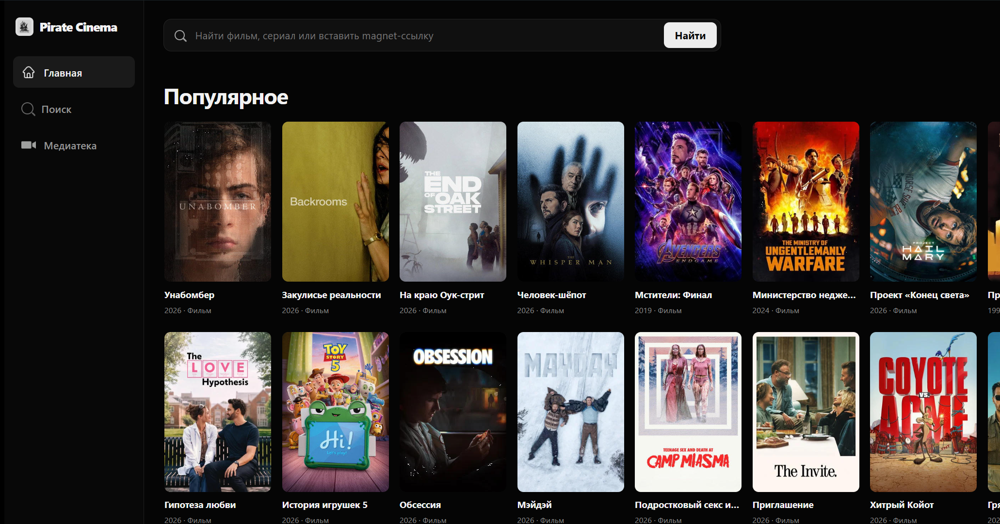

# Pirate Cinema

**Русский** · [English](#english)



Pirate Cinema — локальное медиаприложение на Rust и Dioxus. Настольная версия ищет раздачи через локальный индекс или Torznab, загружает выбранный файл встроенным librqbit и воспроизводит FFmpeg HLS-поток через ArtPlayer. Медиатека и история каждого файла хранятся локально в SQLite.

Windows-установщик включает FFmpeg и Visual C++ Runtime. TorrServer, MPV и отдельный GStreamer больше не требуются.

## Состав проекта

| Компонент | Назначение |
| --- | --- |
| Rust + Dioxus Desktop | интерфейс и локальная логика приложения |
| librqbit | встроенный BitTorrent-движок |
| FFmpeg + HLS + ArtPlayer | подготовка и воспроизведение видео внутри приложения |
| SQLite | медиатека, настройки сопоставления и история просмотра |
| Cinemeta, TVmaze, Wikidata и Wikipedia | общедоступные метаданные и постеры; история им не передаётся |
| Jackett/Prowlarr Torznab | необязательный дополнительный поиск раздач |

В репозитории также находится экспериментальный Android-клиент на Dioxus Mobile. Он не входит в настольный релиз и пока использует отдельно установленный mpv-android.

## Возможности

- локальный поиск по индексу RuTor и опциональный Jackett/Prowlarr Torznab;
- добавление `magnet:`-ссылок из приложения и браузера;
- медиатека с постерами, русскими описаниями, фильтрами и сортировкой;
- локальные типографические обложки с режимами «Авто», «Локальные» и «Постеры»;
- локальные списки «Избранное» и «Смотреть позже»;
- выбор фильма, сезона, серии и конкретного видеофайла;
- встроенный ArtPlayer: продолжение просмотра, перемотка, аудиодорожка, полноэкранный режим и следующий эпизод;
- отметка «Просмотрено» при первом запуске файла;
- блок «Продолжить просмотр»;
- онлайн-видео и плейлисты: сезоны, серии, качество, автопереход и локальная история;
- сохранённые плейлисты и недавно просмотренные онлайн-видео на главной;
- локальные резервные копии, диагностика, обновления и системный трей;
- русский и английский интерфейс.

Все пользовательские данные остаются на компьютере. Pirate Cinema обращается к Cinemeta, TVmaze, Wikidata и русской Wikipedia только за общедоступными названиями, описаниями и изображениями; история просмотра им не передаётся.

Онлайн-поиск отправляет источнику введённый запрос, а запуск — идентификатор выбранного видео или плейлиста. История остаётся локальной. Для просмотра нужен общедоступный поток; ограничения доступа не обходятся.

## Веб-пульт

Веб-пульт управляет только уже открытым ArtPlayer: воспроизведением, перемоткой, громкостью, следующей серией, полноэкранным режимом и озвучкой. Медиатека, поиск и magnet-ссылки с телефона недоступны.

1. Подключите телефон и компьютер к одной Wi-Fi сети.
2. Запустите видео и откройте в настройках ArtPlayer пункт **Веб-пульт → Показать QR-код**. Пульт также можно включить на странице **Настройки** приложения.
3. Отсканируйте QR-код камерой телефона и откройте локальную страницу.
4. При желании выберите в меню браузера **Добавить на главный экран**. Pirate Cinema должен оставаться запущенным.

Пульт выключен по умолчанию, слушает только локальную сеть на порту `8787` и защищён случайным адресом-токеном. Если страница не открывается, разрешите Pirate Cinema доступ к частным сетям в брандмауэре Windows.

## Установка

Готовые пакеты находятся в [последнем релизе](https://github.com/cyberboy1999/pirate-cinema/releases/latest). Все сборки предназначены для 64-битных систем.

### Windows 10/11

Скачайте `Pirate-Cinema-Setup-*-win-x64.exe`. Нужен 64-битный Windows 10/11 и Microsoft Edge WebView2 Runtime. FFmpeg и Visual C++ Runtime уже входят в установщик. Он обновляет существующую установку или заменяет прежнюю Electron-версию, сохраняя пользовательские данные.

### Linux AppImage

AppImage содержит Pirate Cinema, а FFmpeg, GTK и WebKitGTK использует из системы. Перед первым запуском установите зависимости своей системы.

Debian и Ubuntu:

```sh
sudo apt install ffmpeg libgtk-3-0 libwebkit2gtk-4.1-0 libayatana-appindicator3-1 xdotool libfuse2
```

Fedora, RHEL и совместимые системы:

```sh
sudo dnf install ffmpeg gtk3 webkit2gtk4.1 libayatana-appindicator xdotool fuse-libs
```

Arch Linux и CachyOS:

```sh
sudo pacman -S --needed ffmpeg gtk3 webkit2gtk-4.1 libayatana-appindicator xdotool fuse2
```

После установки зависимостей разрешите запуск AppImage:

```sh
chmod +x Pirate-Cinema-*-x86_64.AppImage
```

## Данные и миграция

Основной профиль Rust хранится в `%LOCALAPPDATA%\Pirate Cinema` на Windows и в `$XDG_DATA_HOME/Pirate Cinema` на Linux. При первом запуске выполняется одноразовый импорт из прежней Electron-версии и предыдущего Rust-прототипа. Импорт добавляет только отсутствующие записи и не изменяет исходные базы.

Торрент-движок librqbit работает внутри приложения и открывает только временный read-only HTTP-порт на `127.0.0.1`. Загруженные части служат временным буфером: при закрытии плеера поток, FFmpeg и загрузка останавливаются, а дисковый буфер удаляется. Остатки после аварийного завершения очищаются при следующем запуске.

## Сборка из исходного кода

Установите стабильный Rust toolchain и системные зависимости Dioxus Desktop, затем выполните:

```sh
cargo test --manifest-path desktop-rust/Cargo.toml
cargo clippy --manifest-path desktop-rust/Cargo.toml --all-targets -- -D warnings
cargo build --manifest-path desktop-rust/Cargo.toml --release --bin pirate-cinema
```

Сторонние компоненты и лицензии перечислены в [`THIRD_PARTY_NOTICES.md`](THIRD_PARTY_NOTICES.md).

---

## English

Pirate Cinema is a local-first media application built with Rust and Dioxus. The desktop app searches a local index or Torznab, downloads the selected file through embedded librqbit, and plays an FFmpeg-generated HLS stream with ArtPlayer. The library and per-file history stay in local SQLite.

### Project components

| Component | Purpose |
| --- | --- |
| Rust + Dioxus Desktop | user interface and local application logic |
| librqbit | embedded BitTorrent engine |
| FFmpeg + HLS + ArtPlayer | in-app video preparation and playback |
| SQLite | library, metadata mappings, and viewing history |
| Cinemeta, TVmaze, Wikidata, and Wikipedia | public metadata and posters; viewing history is never sent |
| Jackett/Prowlarr Torznab | optional additional torrent search |

The repository also contains an experimental Dioxus Mobile Android client. It is not part of the desktop release and currently requires a separately installed mpv-android application.

### Features

- local RuTor index search and optional Jackett/Prowlarr Torznab;
- deterministic local cover art with Auto, Local, and Posters modes;
- local Favorites and Watch Later collections;
- `magnet:` links from the application or browser;
- a poster library with descriptions, filters, and sorting;
- movie, season, episode, and exact-file selection;
- embedded ArtPlayer resume, seeking, audio-track memory, fullscreen, and next episode;
- launch-based Viewed markers and Continue Watching;
- online videos and playlists with episode selection, quality memory, auto-next, and local history;
- saved playlists and recently watched online videos on Home;
- local backup, diagnostics, updates, and system tray;
- Russian and English interfaces.

Playback history stays on the computer. Cinemeta, TVmaze, Wikidata, and Russian Wikipedia receive only public metadata queries, never the local history database.

Online sources receive explicit search queries and selected video/playlist identifiers, not the history database. Playback requires an accessible public stream; access restrictions are not bypassed.

### Web remote

The Web remote controls only an already active ArtPlayer session: play/pause, seeking, volume, next episode, fullscreen, and audio track. It cannot browse the library, search, or submit magnet links.

1. Connect the phone and computer to the same Wi-Fi network.
2. Start a video, then open **Web remote → Show QR code** in ArtPlayer settings. You can also start it from the application **Settings** page.
3. Scan the QR code with the phone camera and open the local page.
4. Optionally use the browser menu to **Add to Home screen**. Pirate Cinema must remain running.

The remote is disabled by default, listens only on the local network at port `8787`, and uses a random token in its URL. If the page does not open, allow Pirate Cinema on private networks in Windows Firewall.

### Installation

Download packages from the [latest release](https://github.com/cyberboy1999/pirate-cinema/releases/latest). Builds target 64-bit systems.

#### Windows 10/11

Run `Pirate-Cinema-Setup-*-win-x64.exe`. It requires 64-bit Windows 10/11 and Microsoft Edge WebView2 Runtime. FFmpeg and Visual C++ Runtime are bundled. The installer updates an existing installation or replaces the former Electron edition while preserving user data.

#### Linux AppImage

The AppImage contains Pirate Cinema and uses the system FFmpeg, GTK, and WebKitGTK. Install the runtime for your distribution before first launch.

Debian and Ubuntu:

```sh
sudo apt install ffmpeg libgtk-3-0 libwebkit2gtk-4.1-0 libayatana-appindicator3-1 xdotool libfuse2
```

Fedora, RHEL, and compatible distributions:

```sh
sudo dnf install ffmpeg gtk3 webkit2gtk4.1 libayatana-appindicator xdotool fuse-libs
```

Arch Linux and CachyOS:

```sh
sudo pacman -S --needed ffmpeg gtk3 webkit2gtk-4.1 libayatana-appindicator xdotool fuse2
```

Then make the AppImage executable:

```sh
chmod +x Pirate-Cinema-*-x86_64.AppImage
```

### Data migration

The Rust profile lives in `%LOCALAPPDATA%\Pirate Cinema` on Windows and `$XDG_DATA_HOME/Pirate Cinema` on Linux. On first launch it performs a one-time, non-destructive import from the former Electron edition and Rust prototype. Existing source databases are never modified.

The embedded librqbit engine exposes only an ephemeral read-only HTTP port on `127.0.0.1`. Downloaded pieces are a temporary playback buffer: closing playback stops the stream, FFmpeg, and torrent activity, then removes the disk buffer. A later launch clears leftovers from an abnormal termination.

### Development

```sh
cargo test --manifest-path desktop-rust/Cargo.toml
cargo clippy --manifest-path desktop-rust/Cargo.toml --all-targets -- -D warnings
cargo build --manifest-path desktop-rust/Cargo.toml --release --bin pirate-cinema
```

Third-party components and licenses are listed in [`THIRD_PARTY_NOTICES.md`](THIRD_PARTY_NOTICES.md).

Готовому AppImage не нужны Rust и компилятор. Нужны FFmpeg, GTK3,
WebKitGTK 4.1 и GStreamer-декодеры: FFmpeg приложения не заменяет
декодеры HTML5-видео внутри WebKitGTK.

Ubuntu / Debian:

```sh
sudo apt update
sudo apt install ffmpeg libgtk-3-0 libwebkit2gtk-4.1-0 libayatana-appindicator3-1 librsvg2-2 xdotool libfuse2 gstreamer1.0-plugins-base gstreamer1.0-plugins-good gstreamer1.0-plugins-bad gstreamer1.0-libav
```

В новых Ubuntu пакет FUSE может называться `libfuse2t64`.

Arch Linux / CachyOS:

```sh
sudo pacman -Syu --needed ffmpeg gtk3 webkit2gtk-4.1 libayatana-appindicator librsvg xdotool fuse2 gst-plugins-base gst-plugins-good gst-plugins-bad gst-libav
chmod +x Pirate-Cinema-*-x86_64.AppImage
```

После установки декодеров полностью закройте и снова запустите приложение.
При ошибках EGL/Mesa проверьте драйвер GPU и доступ текущего пользователя
к `/dev/dri/renderD*`. Программная отрисовка пригодна для диагностики,
но не является рекомендуемой постоянной настройкой.

### English

The AppImage needs system FFmpeg, GTK3, WebKitGTK 4.1 and GStreamer codecs.
Rust and a compiler are only required when building from source. Use the
Ubuntu/Debian or Arch/CachyOS commands above; restart the app after installing
codecs. The FFmpeg executable does not supply codecs to WebKitGTK HTML5 video.
On recent Ubuntu versions, use `libfuse2t64` if `libfuse2` is unavailable.
EGL/Mesa failures require checking GPU drivers and access to `/dev/dri/renderD*`.

Package references: [Arch WebKitGTK](https://archlinux.org/packages/extra/x86_64/webkit2gtk-4.1/),
[Arch gst-libav](https://archlinux.org/packages/extra/x86_64/gst-libav/),
[Ubuntu GStreamer packages](https://packages.ubuntu.com/search?keywords=gstreamer).
